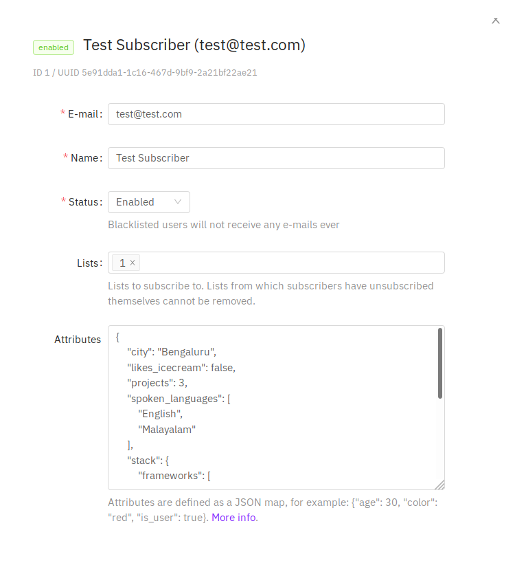
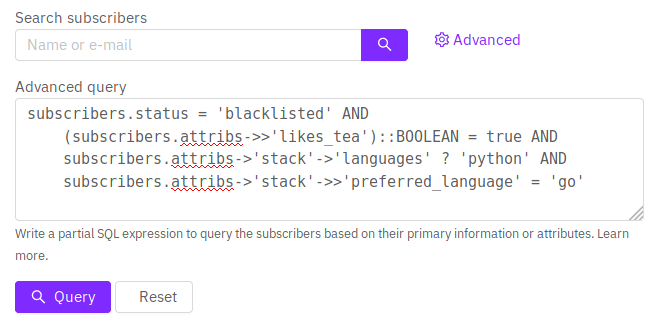

# Querying and segmenting subscribers

listmonk allows the writing of partial Postgres SQL expressions to query, filter, and segment subscribers.

## Database fields

These are the fields in the subscriber database that can be queried.

| Field                    | Description                                                                                         |
| ------------------------ | --------------------------------------------------------------------------------------------------- |
| `subscribers.uuid`       | The randomly generated unique ID of the subscriber                                                  |
| `subscribers.email`      | E-mail ID of the subscriber                                                                         |
| `subscribers.name`       | Name of the subscriber                                                                              |
| `subscribers.status`     | Status of the subscriber (`enabled`, `disabled`, `blocklisted`)                                     |
| `subscribers.attribs`    | Map of arbitrary attributes represented as JSON. Accessed via the `->` and `->>` Postgres operator. |
| `subscribers.created_at` | Timestamp when the subscriber was first added                                                       |
| `subscribers.updated_at` | Timestamp when the subscriber was modified                                                          |

## Sample attributes

Here's a sample JSON map of attributes assigned to an imaginary subscriber.

```json
{
  "city": "Bengaluru",
  "likes_tea": true,
  "spoken_languages": ["English", "Malayalam"],
  "projects": 3,
  "stack": {
    "frameworks": ["echo", "go"],
    "languages": ["go", "python"],
    "preferred_language": "go"
  }
}
```



## Sample SQL query expressions



#### Find a subscriber by e-mail

```sql
-- Exact match
subscribers.email = 'some@domain.com'

-- Partial match to find e-mails that end in @domain.com.
subscribers.email LIKE '%@domain.com'

```

#### Find a subscriber by name

```sql
-- Find all subscribers whose name start with John.
subscribers.email LIKE 'John%'

```

#### Multiple conditions

```sql
-- Find all Johns who have been blocklisted.
subscribers.email LIKE 'John%' AND subscribers.status = 'blocklisted'
```

#### Querying subscribers who viewed the campaign email

```sql
-- Find all subscribers who viewed the campaign email.
EXISTS(SELECT 1 FROM campaign_views WHERE campaign_views.subscriber_id=subscribers.id AND campaign_views.campaign_id=<put_id_of_campaign>)
```

#### Querying attributes

```sql
-- The ->> operator returns the value as text. Find all subscribers
-- who live in Bengaluru and have done more than 3 projects.
-- Here 'projects' is cast into an integer so that we can apply the
-- numerical operator >
subscribers.attribs->>'city' = 'Bengaluru' AND
    (subscribers.attribs->>'projects')::INT > 3
```

#### Querying nested attributes

```sql
-- Find all blocklisted subscribers who like to drink tea, can code Python
-- and prefer coding Go.
--
-- The -> operator returns the value as a structure. Here, the "languages" field
-- The ? operator checks for the existence of a value in a list.
subscribers.status = 'blocklisted' AND
    (subscribers.attribs->>'likes_tea')::BOOLEAN = true AND
    subscribers.attribs->'stack'->'languages' ? 'python' AND
    subscribers.attribs->'stack'->>'preferred_language' = 'go'

```

To learn how to write SQL expressions to do advancd querying on JSON attributes, refer to the Postgres [JSONB documentation](https://www.postgresql.org/docs/11/functions-json.html).

## Segmenting campaigns

A campaign can be sent to a segment of the subscribers in its lists instead of all of them. On the campaign page, open the **Segmentation** tab and enter an SQL expression. When the campaign runs, only the subscribers in the campaign's lists that match the expression receive it. The usual rules still apply on top of the segment: blocklisted and unsubscribed subscribers (and unconfirmed subscribers on double opt-in lists) are never sent to.

The segment uses the same partial SQL expressions as the advanced subscriber query documented above.

```sql
-- Send to Turkish-speaking subscribers of a particular tenant.
subscribers.attribs->>'tenant_id' = 'tenant_x' AND subscribers.attribs->>'lang' = 'tr'
```

The **Dry run** button runs the segment against the selected lists without saving or sending anything. It shows the number of matching subscribers (e.g. "Matches 1,420 of 10,000 subscribers") along with a sample of them.

Segments can also be managed over the API with the `segment_query` field of the [campaigns API](apis/campaigns.md), and dry-run with [POST /api/campaigns/segment/preview](apis/campaigns.md#post-apicampaignssegmentpreview) and [GET /api/campaigns/{campaign_id}/segment/preview](apis/campaigns.md#get-apicampaignscampaign_idsegmentpreview).

Setting or changing a campaign's segment requires the `subscribers:sql_query` permission. The expression may only access the same tables as the advanced subscriber query and runs in a read-only transaction. It may not contain comments, semicolons, or unbalanced parentheses.
